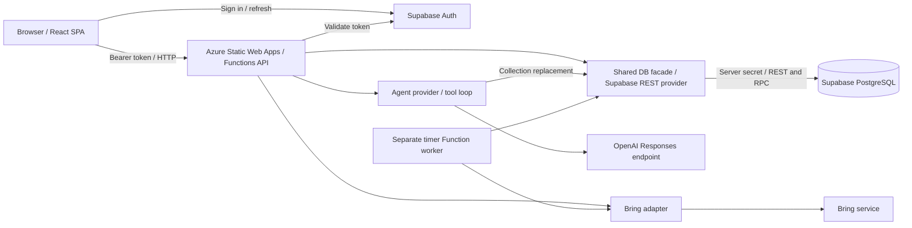
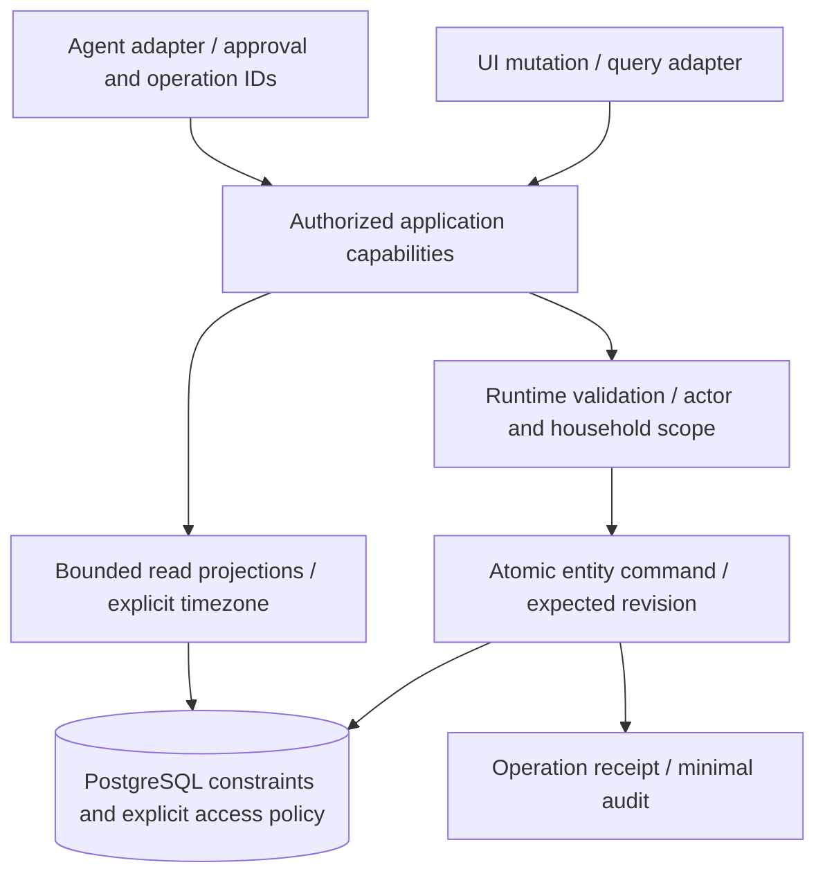

# Family Butler V2 — Architectural Review

**Review date:** 20 October 2026 (Europe/Zurich)  
**Repository:** https://github.com/ivoarnet/family-butler-v2  
**Reviewed revision:** `1ce328712464309fe35c936c5b14015e715741ed` — Simplify the grocery list workspace (#131)  
**Method:** source and configuration review, local API tests, JavaScript syntax checks, and isolated in-memory failure reproductions. Source links below are pinned to this revision. Recommendations describe proposed changes, not changes implemented by this review.

## Executive assessment

The modular monolith is an appropriate foundation for this product. React, Azure Functions, and PostgreSQL do not need to be replaced. The immediate architectural problem is inconsistent enforcement of ownership, atomicity, and concurrency across modules. Groceries has transactional commands, revisions, synchronization fencing, and carefully protected credentials; core calendar and contact writes still replace entire collections through several independent requests.

**Recommendation: resolve the P1 findings before expanding production usage or adding new write-capable agent features.** Highest priority is tenant isolation, followed by preventing data loss. A larger module framework, microservices, another database provider, or a message broker would not address these defects.

No production compromise, outage, or data loss is asserted. The review confirms vulnerable code paths and deterministic local failure modes; actual production reachability and database grants require environment verification.

## Scope, confidence, and limitations

Reviewed the 205 tracked repository files as an inventory, with detailed inspection of executable entry points, authentication, persistence providers, agent orchestration and mutation tools, SQL definitions, grocery worker, frontend state management, deployment workflow, package/build configuration, tests, and architecture/setup documentation. Images were treated as supporting documentation rather than evidence of runtime behavior. Planned Tasks, recipes, Gamification, reports/exports, MCP integrations, and tvOS capabilities were distinguished from implemented code.

This is a source-level architectural review, not a production penetration test, dependency vulnerability audit, accessibility certification, load test, or compliance assessment. No live Supabase, Azure, Bring!, or model-provider account was used. Azure settings, branch protection, database grants/RLS, configured REST row limits, backup retention, secret-store policies, deployed versions, billing controls, and runtime telemetry were unavailable.

Confidence labels:

- **Confirmed:** directly present in source; local reproduction is stated where performed.
- **Conditional:** source lacks a safeguard, but exposure depends on configuration or scale.
- **Design gap:** an explicit recommendation for resilience or maintainability, not a demonstrated production failure.

## Current architecture

| Boundary | Implemented behavior | Architectural implication |
| --- | --- | --- |
| Browser | Supabase authentication; manual pathname routing; shared household state in `App.tsx`; feature/page UI | Browser edits commonly trigger a whole-household PUT. |
| API | Anonymous HTTP triggers with application-level authentication in most handlers | Every endpoint must independently authenticate and authorize; Tasks currently does neither. |
| Persistence | A cached provider facade calls Supabase REST using a server secret | User-token RLS does not protect service-role operations; API and database invariants are essential. |
| Ownership | Households are selected by `created_by_user_id` | This is an owner-only product today. Household members are domain records, not additional authorized users. |
| Calendar/contact writes | Delete omitted records, then globally upsert supplied IDs | Large failure surface for stale snapshots, partial failures, and ownership mistakes. |
| Childcare / Parenting Time | Separate domain resolvers and household checks; feature SQL constraints and policies | Useful examples of keeping derived calendar projections separate from generic events. |
| Groceries / Bring | Transactional RPC, revisions, pending changes, leases/fences, encrypted credentials | Strongest existing model for safe command processing; external side effects still require operational controls. |
| Background execution | Standalone timer worker outside the SWA HTTP API artifact | Correct separation in repository design; deployment and monitoring remain manual. |
| Delivery | One GitHub Actions workflow builds/deploys SWA | No repository-defined API-test, SQL-test, or Storybook-play gate before deployment. |

### Strengths to preserve

- Feature-first UI folders, shared theme/form controls, and a small module navigation registry provide a reasonable product structure.
- Childcare and Parenting Time are calculated projections with independent models, not duplicated generic calendar events. Parenting tests cover timezone/DST and ISO-week transitions.
- The DB facade and isolated Bring/model adapters make dependencies replaceable and testable without requiring separate services.
- Grocery SQL uses locking, revisions, lease tokens, fencing, and constrained service-role RPC access. Invalid remote snapshots are rejected rather than interpreted as empty data.
- Bring credentials use AES-256-GCM, fresh nonces, and household-bound authenticated data. Credential settings are write-only, and provider errors are deliberately sanitized.
- The test suite contains substantial domain, authorization, synchronization, and failure-path coverage. Storybook contains interaction scenarios, even though the delivery workflow does not execute them.
- Existing architecture documentation explicitly separates implemented and proposed features. Continue this discipline when updating older setup and overview text.

## Prioritized findings

P1 = address before broader production rollout; P2 = next hardening iteration; P3 = subsequent maintainability improvement. No P0 is assigned without evidence of an active production emergency. Ordering within a priority reflects impact and dependencies. Effort is a rough engineering estimate: S = 1–2 days, M = 3–5 days, L = 1–2 weeks, excluding independent security review and rollout. Owners are suggested responsibilities, not assigned people.

| Order | ID | Priority | Finding | Confidence | Effort | Suggested owner |
| --- | --- | --- | --- | --- | --- | --- |
| 1 | AR-01 | P1 | Event IDs can cross household boundaries through global upsert | Confirmed code path | M | API / database |
| 2 | AR-02 | P1 | Tasks exposes global reads and writes without authentication | Confirmed + local reproduction | S | API |
| 3 | AR-03 | P1 | Core schema does not establish browser-facing RLS/grant protection | Conditional exposure | M | Database / security |
| 4 | AR-04 | P1 | Whole-household autosave loses concurrent changes | Confirmed design | L | API / frontend |
| 5 | AR-05 | P1 | Household saves are non-atomic and delete before persistence succeeds | Confirmed design | L | API / database |
| 6 | AR-06 | P1 | Parallel agent mutation tools overwrite shared state | Confirmed + local reproduction | S–M | Agent / API |
| 7 | AR-07 | P1 | Core reads can truncate collections that are later replaced | Conditional on data size / REST cap | M | API / database |
| 8 | AR-08 | P1 | Agent payload limits trust client metadata; work/cost budgets are incomplete | Confirmed missing controls | M | Agent / API |
| 9 | AR-09 | P1 | Deployment has no explicit correctness gates and bypasses the lockfile for API install | Confirmed workflow | M | Delivery |
| 10 | AR-10 | P2 | Outbound auth, database, and LLM requests lack explicit deadlines | Confirmed | M | API |
| 11 | AR-11 | P2 | Agent writes lack durable operation results, audit, and approval binding | Confirmed / design gap | L | Agent / API |
| 12 | AR-12 | P2 | Core validation and domain contracts diverge across write paths | Confirmed | M | API / frontend |
| 13 | AR-13 | P2 | Calendar and agent lack one household timezone contract | Confirmed | M | Calendar / agent |
| 14 | AR-14 | P2 | Worker iteration can starve later households | Conditional at scale | M | Integrations |
| 15 | AR-15 | P2 | Operational failures are suppressed; recovery/migrations rely on manual procedures | Confirmed / environment unknowns | M–L | Operations / database |
| 16 | AR-16 | P3 | Actual application boundaries remain concentrated in large shared files | Confirmed design gap | L, incremental | Frontend / API |

### AR-01 — Event identity is not protected at the tenant boundary

**Evidence:** [household PUT validation](https://github.com/ivoarnet/family-butler-v2/blob/1ce328712464309fe35c936c5b14015e715741ed/api/households/index.js#L487) checks ownership for members, contacts, event types, and day configurations, but has no equivalent event-ID ownership check. [replaceEvents](https://github.com/ivoarnet/family-butler-v2/blob/1ce328712464309fe35c936c5b14015e715741ed/api/shared/db/providers/supabase.js#L482) upserts on globally unique `id`, including the caller's `household_id`. [add_event](https://github.com/ivoarnet/family-butler-v2/blob/1ce328712464309fe35c936c5b14015e715741ed/api/shared/agent/tools/addEventTool.js) also accepts a supplied UUID. The core schema has no event tenant-immutability trigger.

**Impact:** an authenticated owner who knows an event UUID from another household can supply that UUID with their own valid members and overwrite/reassign the event through the privileged provider. UUID unpredictability reduces discovery but does not establish authorization. A mocked handler accepted such a payload with status 200 and forwarded the foreign ID to `replaceEvents`; the final database effect follows from the global upsert definition and was not tested against production.

**Recommendation:** generate IDs server-side for creates; update existing events with both household ID and event ID predicates. Reject IDs not owned by the authorized household inside the same database transaction. Make tenant ownership immutable at the database boundary. Audit the other check-then-upsert collections for races rather than adding only another preflight lookup.

**Acceptance:** two-household database integration tests prove that REST and agent creates/updates cannot modify or transfer another household's entity, including simultaneous conflicting requests. Owner and non-owner results must not disclose foreign record contents.

### AR-02 — Tasks is an exposed global data surface

**Evidence:** [Tasks handler](https://github.com/ivoarnet/family-butler-v2/blob/1ce328712464309fe35c936c5b14015e715741ed/api/tasks/index.js), [anonymous trigger](https://github.com/ivoarnet/family-butler-v2/blob/1ce328712464309fe35c936c5b14015e715741ed/api/tasks/function.json), and [unscoped provider operations](https://github.com/ivoarnet/family-butler-v2/blob/1ce328712464309fe35c936c5b14015e715741ed/api/shared/db/providers/supabase.js#L575). The documented `tasks` table has no household column. No checked-in SWA route policy compensates for this. An isolated invocation with empty headers returned 200 and the mock global task list.

**Impact:** if deployed as defined, unauthenticated callers can list all tasks and insert records using server credentials. Disabling the Tasks navigation item does not disable the API. Even an external authentication gate alone would leave all signed-in users sharing the same global records.

**Recommendation:** remove/disable the placeholder endpoint until Tasks is implemented, or add authentication, household ownership, tenant-scoped schema and provider operations, and bounded input. Confirm whether existing global task records need quarantine or migration.

**Acceptance:** missing/invalid credentials are denied; household A cannot read or mutate household B's tasks; deployments contain no reachable unauthenticated placeholder write endpoints.

### AR-03 — Core database access policy is absent from the reproducible schema

**Evidence:** the [core setup SQL](https://github.com/ivoarnet/family-butler-v2/blob/1ce328712464309fe35c936c5b14015e715741ed/docs/SUPABASE.md#L64) creates households, members, contacts, tasks, event types, events, and day configurations without enabling RLS or defining browser-role grants/revocations. Feature migrations do establish RLS. The browser necessarily receives a publishable key for authentication.

**Impact:** where these core tables have browser-role grants and are exposed through the Data API, direct REST access can bypass the Functions ownership checks. Core household writes could also undermine the ownership predicates used by feature policies. Live grants, exposed schemas, and manually added policies were not inspected; this is a confirmed schema omission with conditional deployed exposure.

**Recommendation:** codify an API-only table-access policy by revoking browser-role access, or implement deliberately supported owner-scoped RLS for every core table and required operation. Explicitly preserve any table privileges needed by feature-policy predicates and test their behavior. Keep server-secret writes independently authorized because RLS is not their protection boundary.

**Acceptance:** fresh and upgraded databases deny anonymous access and cross-owner access through direct Supabase REST; same-owner permitted operations and feature RLS still work. Include checks of actual grants and RLS settings in deployment validation.

### AR-04 — Whole-state autosave is unsafe under concurrency

**Evidence:** [writeHousehold](https://github.com/ivoarnet/family-butler-v2/blob/1ce328712464309fe35c936c5b14015e715741ed/frontend/src/App.tsx#L204) sends all core collections. The [persistence effect](https://github.com/ivoarnet/family-butler-v2/blob/1ce328712464309fe35c936c5b14015e715741ed/frontend/src/App.tsx#L456) runs after loading and on state/token/context changes, without a dirty revision, write queue, or server version check. Its cancellation flag only ignores responses; it cannot stop an accepted server write. Agent tools replace the same collections from request-time snapshots.

**Impact:** two tabs load the same state; one adds an event; the other edits a contact and sends its old event list, deleting the new event. Rapid edits can also produce overlapping PUTs whose final server order differs from the UI. Merely reading/refreshing state can trigger another write, increasing conflicts.

**Recommendation:** move to explicit entity-level commands with optimistic concurrency (`expectedVersion` or ETag) and conflict responses. Track dirty mutations, serialize writes per affected aggregate, and invalidate/refetch relevant queries after successful commits. A debounce is useful for request volume but cannot provide cross-client correctness. Require the same concurrency contract for UI and agents.

**Acceptance:** two-tab, UI-versus-agent, delayed-response, and token-refresh scenarios preserve both independent edits or return a recoverable conflict. Initial reads issue no write. A stale write never silently wins.

### AR-05 — A household save can leave a partially committed aggregate

**Evidence:** [PUT persistence sequence](https://github.com/ivoarnet/family-butler-v2/blob/1ce328712464309fe35c936c5b14015e715741ed/api/households/index.js#L510) makes six independent calls. [Collection replacement](https://github.com/ivoarnet/family-butler-v2/blob/1ce328712464309fe35c936c5b14015e715741ed/api/shared/db/providers/supabase.js#L345) deletes omitted rows before upsert. Non-array or missing collections parse as empty arrays. The core schema uses immediate unique constraints on household sort positions and event-type deletion sets references to null.

**Impact:** a later validation/constraint/network failure can leave prior deletions and changes committed. For example, contacts can be removed before a later event write fails. Deleting event types can change event references even if the remainder of the save fails. Reordering records can collide with immediate uniqueness constraints. An incomplete client payload can unintentionally clear data.

**Recommendation:** prefer narrow transactional commands. If whole-state PUT remains temporarily, validate the complete body, compare revision, and commit every dependent change inside one PostgreSQL transaction/RPC. Design reorder operations for their uniqueness constraints. Require explicit deletion intent and prohibit missing collections from implying deletion.

**Acceptance:** fault injection after each persistence stage leaves the database unchanged; invalid references/dates and duplicate IDs are rejected before changes; reorder swaps succeed; stale revisions conflict; partial payloads never delete omitted collections.

### AR-06 — Agent tool parallelism deterministically loses mutations

**Evidence:** [provider tool dispatch](https://github.com/ivoarnet/family-butler-v2/blob/1ce328712464309fe35c936c5b14015e715741ed/api/shared/agent/providers/openaiProvider.js#L166) uses `Promise.all`. Mutation tools capture shared `householdState`, build a replacement array, await persistence, then assign it back. Two concurrent `add_event` calls in an isolated harness produced write snapshots `[["First"],["Second"]]` and final state `["Second"]`.

**Impact:** a single request to add two events can report both operations as successful while retaining only one. The same pattern affects contacts and day configurations. Errors in one parallel operation do not roll back successful sibling writes.

**Recommendation:** serialize mutation tools immediately; parallelize only demonstrably independent reads. Then replace collection writes with atomic entity commands and operation IDs so separate chat requests are also safe. Treat the sequential change as containment, not the final concurrency solution.

**Acceptance:** multiple same-turn mutations all survive; mixed read/write dependencies observe committed state; concurrent separate requests preserve both results or conflict; partial success is reported accurately.

### AR-07 — Incomplete core reads can become authoritative destructive writes

**Evidence:** [getHouseholdWithRelations](https://github.com/ivoarnet/family-butler-v2/blob/1ce328712464309fe35c936c5b14015e715741ed/api/shared/db/providers/supabase.js#L285) reads entire collections without pagination, a visible-date range, or completeness verification. Childcare and Parenting Time providers do paginate, demonstrating that the core path differs. The returned core snapshot feeds full replacement writes.

**Impact:** if a REST response hits the deployment's row cap, records beyond that cap are absent from the browser/agent snapshot. A subsequent replace call can delete those records as omitted. Even below a cap, every page load and small edit transfers unnecessary contact/event data. No particular deployed cap is assumed here.

**Recommendation:** add explicit pagination and completeness handling immediately; reject destructive replacement from partial snapshots. Introduce date-window calendar queries and separate contact/member queries alongside entity commands. Use stable ordering and suitable household/date indexes, validating plans with real data.

**Acceptance:** tests with more records than the configured REST cap retain every record after reads and edits. Visible calendar queries return bounded data, with recurrence and multi-day overlap semantics preserved.

### AR-08 — Agent ingress and execution budgets are incomplete

**Evidence:** [attachment normalization](https://github.com/ivoarnet/family-butler-v2/blob/1ce328712464309fe35c936c5b14015e715741ed/api/agent-chat/index.js#L48) checks caller-supplied `sizeBytes` and MIME but does not validate decoded size, canonical base64, or file signatures. History/text are unbounded in application code. The provider caps the loop at four iterations, but does not cap calls per response or specify an output-token budget. No per-user/household quota or rate limit is implemented in the repository.

**Impact:** authenticated requests can bypass the stated per-file limit by understating metadata, retain large strings in memory, or consume disproportionate model/tool resources. Platform body limits may cap the request but do not enforce the advertised file or business budget. This is not an unauthenticated upload endpoint.

**Recommendation:** enforce an aggregate body limit before JSON parsing where supported; validate encoded and decoded lengths and supported file signatures; bound text/history and attachment count/bytes; define request deadlines, per-turn tool/output limits, and per-principal usage/concurrency quotas. Record sanitized usage and rejection metrics.

**Acceptance:** oversized content with `sizeBytes: 1`, malformed base64, MIME/signature mismatch, huge history, and excessive tool calls are rejected before costly provider work. Limits remain enforced across multiple instances.

### AR-09 — Delivery does not enforce the existing verification capabilities

**Evidence:** the [only workflow](https://github.com/ivoarnet/family-butler-v2/blob/1ce328712464309fe35c936c5b14015e715741ed/.github/workflows/azure-static-web-apps-polite-hill-0ea169003.yml) builds/deploys without calling `test:api` or running SQL integration or Storybook interactions. Its API install explicitly uses `--package-lock=false`. The [API build](https://github.com/ivoarnet/family-butler-v2/blob/1ce328712464309fe35c936c5b14015e715741ed/api/package.json) prints a message rather than checking source. Existing PostgreSQL tests skip unless `GROCERY_TEST_PG_SOCKET` is configured. Root and worker packaging do not share a complete locked deployment procedure.

**Impact:** authorization, SQL constraints, and races can regress without a failing deployment check. A successful frontend build or Storybook static build is not evidence that interactions or backend invariants passed. Standalone API/worker dependency resolution can diverge from the reviewed root lockfile. External branch protection may exist, but no such gate is defined here.

**Recommendation:** add a validation job with locked install, syntax/type checks, API tests, a disposable PostgreSQL service applying migrations and executing non-skipped DB tests, and focused Storybook interaction tests. Build the actual deployable API/worker artifacts from locked dependencies and smoke-test them. Keep the standalone SDK packaging fix while making it reproducible. Promote only validated artifacts and make relevant status checks required.

**Acceptance:** an ownership regression, broken migration, or failed interaction prevents deployment; SQL tests cannot silently skip in CI; built artifacts load the Bring SDK; identical lockfiles produce consistent dependency trees.

### AR-10 — Core outbound requests have no explicit timeout/cancellation policy

**Evidence:** [auth token lookup](https://github.com/ivoarnet/family-butler-v2/blob/1ce328712464309fe35c936c5b14015e715741ed/api/shared/auth.js), [Supabase request adapter](https://github.com/ivoarnet/family-butler-v2/blob/1ce328712464309fe35c936c5b14015e715741ed/api/shared/db/providers/supabase.js#L135), and [LLM request](https://github.com/ivoarnet/family-butler-v2/blob/1ce328712464309fe35c936c5b14015e715741ed/api/shared/agent/providers/openaiProvider.js#L135) call `fetch` without application deadlines. Bring has timeout wrappers, but `Promise.race` does not cancel an underlying SDK request.

**Impact:** dependency stalls occupy executions until lower-level/platform timeouts. A timed-out external mutation can still complete after the caller starts recovery; a retry must not assume no side effect occurred. Auth currently treats every non-OK upstream status as invalid credentials, obscuring upstream outages.

**Recommendation:** propagate a request deadline through adapters using abortable calls, distinct unauthenticated versus unavailable errors, and bounded retry/backoff for safe operations. Mutations need idempotency/reconciliation before retry. Preserve Bring's lease/fence protections and explicitly model uncertain remote outcomes where cancellation is unavailable.

**Acceptance:** stalled dependencies return bounded, sanitized errors; auth outages yield a retryable unavailable response; delayed external completions cannot be mistaken for confirmed failure or cause uncontrolled duplicate writes.

### AR-11 — Agent execution has no durable result/approval boundary

**Evidence:** the [four-iteration loop](https://github.com/ivoarnet/family-butler-v2/blob/1ce328712464309fe35c936c5b14015e715741ed/api/shared/agent/providers/openaiProvider.js#L134) can execute writes on its final iteration and then fail because there is no assistant text. A tool exception aborts response construction after earlier writes may have committed. [Confirmation](https://github.com/ivoarnet/family-butler-v2/blob/1ce328712464309fe35c936c5b14015e715741ed/api/shared/agent/tools/addDayConfigurationsTool.js) is a model-supplied boolean; no persisted user-bound proposal or operation receipt exists. The endpoint returns only reply/provider/model. Provider requests also have no explicit application retention/storage policy in their payload.

**Impact:** users may see an error after successful changes and retry. In-memory duplicate detection is not durable idempotency. Where product policy requires approval, the model can assert approval without a server-verified user action. Attachments and conversational content are forwarded externally, but the implementation lacks a consolidated, testable retention/minimization contract. This does not establish any particular provider retention duration.

**Recommendation:** persist a bounded operation journal with request/tool operation IDs and structured outcomes; return committed/failed/pending actions even when text generation fails. For confirmation-required actions, create a server proposal bound to actor, household, exact payload, revision, and expiry, and require an explicit authenticated approval action. Separate attachment content from trusted instructions. Define provider-storage and app-log retention settings deliberately, with minimum necessary data.

**Acceptance:** retrying the same operation creates no duplicate effect; loop exhaustion and partial failures report actual writes; model/attachment text cannot fabricate a valid approval; audit records reconstruct actor/action/outcome without storing credentials or unnecessary file content.

### AR-12 — Write paths implement different domain validation

**Evidence:** household parsing, agent event/contact models, frontend normalization, and shared validators each define overlapping rules. [Agent event dates](https://github.com/ivoarnet/family-butler-v2/blob/1ce328712464309fe35c936c5b14015e715741ed/api/shared/agent/tools/eventModel.js#L33) and household event dates use shape-only checks, while [shared validateDate](https://github.com/ivoarnet/family-butler-v2/blob/1ce328712464309fe35c936c5b14015e715741ed/api/shared/validation.js#L16) verifies actual calendar dates. Household contact integer parsing is permissive; collection shapes and unknown fields are not consistently rejected. `member_ids` is a UUID array without core event member-reference enforcement. Error classification in households relies on message substrings and can expose raw persistence errors.

**Impact:** the same action behaves differently through UI and agent, invalid data may fail only after destructive writes, and members can be removed leaving event arrays with stale IDs. A future client would need to reproduce implicit contracts. TypeScript frontend types do not validate incoming JSON or the JavaScript API.

**Recommendation:** introduce shared server application commands and runtime schemas for core entities; make HTTP and agent adapters call them. Publish typed API contracts or OpenAPI and use stable error codes/statuses. Enforce same-household references in database transactions, using a join table or well-tested triggers for member relationships. Sanitize unexpected errors.

**Acceptance:** table-driven contract tests send identical valid/invalid payloads through HTTP and agent paths and obtain consistent results; impossible dates, duplicate IDs, malformed shapes, invalid recurrence, and orphaned references are rejected atomically.

### AR-13 — Relative dates and display timezones can disagree

**Evidence:** [agent runtime context](https://github.com/ivoarnet/family-butler-v2/blob/1ce328712464309fe35c936c5b14015e715741ed/api/agent-chat/index.js#L21) explicitly resolves relative dates against UTC; the birthday tool uses server-local `new Date()`; the dashboard derives dates and formats parenting timestamps in the browser timezone. Parenting plans separately persist an IANA `timeZone`. The household model has a holiday region but no authoritative calendar timezone.

**Impact:** shortly after midnight in Zurich, the agent's UTC day can still be yesterday, so “tomorrow” or the next birthday can differ from the visible calendar. A travelling user's browser can display parenting handovers differently from the household's intended schedule.

**Recommendation:** establish a persisted household IANA timezone, distinguish date-only values from instants, inject a clock/timezone into tools, and format projections consistently with an explicit user/household display policy. Preserve the existing DST-aware parenting resolver.

**Acceptance:** fake-clock tests cover Zurich midnight, DST gaps/overlaps, ISO-year boundaries, and a browser in another timezone; UI, agent, and birthday results agree on the household date.

### AR-14 — The grocery worker has no fair progress cursor

**Evidence:** [worker](https://github.com/ivoarnet/family-butler-v2/blob/1ce328712464309fe35c936c5b14015e715741ed/workers/grocery-sync/index.js#L14) starts each poll with a 180-second deadline and processes households/lists sequentially. [connectionHouseholds](https://github.com/ivoarnet/family-butler-v2/blob/1ce328712464309fe35c936c5b14015e715741ed/api/shared/bring-connections.js#L44) restarts from the beginning, has a 100-page cap, and saves no progress cursor. A list sync has its own substantial time budget.

**Impact:** when early accounts repeatedly consume the run budget, later households may never be reached despite recurring timer executions. This is a scale/outage fairness issue, not proof that today's workload exceeds capacity. Existing list leases help concurrency but do not provide fair scheduling.

**Recommendation:** first add a durable rotating cursor or next-due schedule, per-household/list budgets, and backlog-age metrics. If measured demand requires it, enqueue bounded list-level work with leases, deduplication, retry/backoff, and failure visibility. A broker is not required simply to fix iteration fairness.

**Acceptance:** a slow/failing first household cannot indefinitely starve later ones; every eligible list meets a defined freshness objective under the agreed workload; interrupted runs resume fairly.

### AR-15 — Operations cannot reliably detect drift or reconstruct recovery

**Evidence:** [worker catches](https://github.com/ivoarnet/family-butler-v2/blob/1ce328712464309fe35c936c5b14015e715741ed/workers/grocery-sync/index.js#L25) deliberately suppress errors; grocery handlers provide limited diagnostics. [health checks](https://github.com/ivoarnet/family-butler-v2/blob/1ce328712464309fe35c936c5b14015e715741ed/api/health/index.js) test core connectivity but not schema compatibility, agent readiness, worker freshness, or credential decryptability. Schema changes are ordered manual SQL instructions. [Supabase setup](https://github.com/ivoarnet/family-butler-v2/blob/1ce328712464309fe35c936c5b14015e715741ed/docs/SUPABASE.md) explicitly requires coordinated API/worker changes and documents key-loss/rotation limitations. Its seed insert omits the required `created_by_user_id`; setup also describes `.env` files without a checked-in Functions settings loader. Several docs contain runner-specific absolute paths and stale feature descriptions.

**Impact:** a timer can appear successful while all sync work fails. Operators cannot distinguish migration mismatch, dependency outage, or overdue work from healthy emptiness. Manual schema/key/config changes create drift and risky recovery dependencies. The repository does not prove that backups or monitoring are absent in production; it does not define or verify them.

**Recommendation:** emit redacted structured events, request/operation correlation IDs, dependency latency/error counts, sync-age/backlog, and bounded failure reasons. Define SLOs and alerts for user-visible availability and freshness. Add ordered versioned migrations with a schema compatibility check and CI bootstrap/upgrade tests. Keep manual infrastructure provisioning if desired, but document API/worker deployment, version compatibility, environment loading, secret rotation, rollback, and backup/restore procedures with RPO/RTO targets. Repair seed and relative-path documentation. Versioned schema migrations do not require introducing infrastructure-as-code.

**Acceptance:** a simulated storage or key failure produces an actionable alert without secrets; a clean checkout can bootstrap a disposable database/runtime; restore drills recover both data and encrypted credentials; rollback/roll-forward between compatible API/worker/schema versions is documented and exercised.

### AR-16 — Module boundaries exist mainly as folder/document conventions

**Evidence:** [App.tsx](https://github.com/ivoarnet/family-butler-v2/blob/1ce328712464309fe35c936c5b14015e715741ed/frontend/src/App.tsx) owns authentication, routing, loading, persistence, profile updates, and feature request wiring. `DashboardPage.tsx` and `SettingsPage.tsx` combine extensive scheduling, network, and presentation logic. API handlers/tools independently orchestrate core writes through a broad shared DB facade; groceries even reuses the childcare-named household authorization query. All top-level pages are statically imported. Generated Vite JS/declarations and build-info files are tracked alongside TypeScript configuration.

**Impact:** changes to one feature affect shared state and transport behavior, adding clients requires copying orchestration, and enforcing the documented “same authorized capability for UI and agents” rule remains difficult. The verified production build emits a single JavaScript asset of 1,128.97 kB minified / 331.30 kB gzip and a chunk-size warning. Static imports make all top-level module pages part of the initial bundle graph; user-perceived startup and interaction costs still require profiling.

**Recommendation:** after correctness fixes, extract a shared authentication/authorized-household context, feature query/mutation hooks, a neutral transport client, and explicit calendar/contact commands. Keep pages focused on composition and give modules public contracts with dependency rules. Measure production chunks and lazy-load large module pages if justified. Stop tracking generated config/build-info artifacts. Retain the monolith and current provider adapter until real requirements justify more abstraction.

**Acceptance:** UI and agent adapters invoke the same tested commands; adding a module does not require editing unrelated persistence logic; dependency checks prevent internal cross-module imports; measured bundle and interaction budgets are enforced where they matter.

## Recommended target and delivery sequence

This is an incremental refactor within the current deployable architecture. Use a transaction/RPC where needed for atomic writes; do not move business rules into duplicate UI and tool implementations. Add an outbox only when a real durable cross-module consumer is implemented.

| Sequence | Work package | Dependencies | Exit evidence |
| --- | --- | --- | --- |
| 1 — Contain exposure | AR-01/02/03; serialize agent mutations from AR-06; reject unsafe payloads from AR-08 | Independent security fixes can begin immediately | Cross-household and unauthenticated API/direct-DB tests; all parallel additions retained |
| 2 — Protect correctness | AR-04/05/07 and shared validation from AR-12 | Tenant-safe write predicates first | Transaction rollback tests; stale-version rejection; above-cap data retained; read-only load |
| 3 — Make delivery enforceable | AR-09 plus minimum migration/bootstrap automation from AR-15 | Start alongside packages 1–2, gate their rollout | Non-skipped DB CI; actual artifact smoke tests; reproducible install |
| 4 — Harden agent and integrations | AR-08/10/11/13/14; operational signals from AR-15 | Safe commands and stable contracts | Bounded provider failures; replay-safe writes; valid approvals; timezone/fairness tests |
| 5 — Reduce maintenance cost | AR-16 and remaining recovery/documentation work | Stabilize contracts before moving code | Smaller composition files; shared capabilities; restore and release runbooks |

Estimate packages independently after confirming runtime/database configuration; do not add row estimates mechanically because several findings share one command/migration refactor. Suggested release rule: no open P1 without an explicit, documented mitigation and owner.

## Validation performed

Local validation used Node.js `v24.14.0` and npm `11.9.0`. The repository documents Node 20+; production runtime compatibility was not verified.

| Check | Result | Interpretation |
| --- | --- | --- |
| Fetch and inspect repository HEAD | Reviewed exact revision shown above | Source baseline is reproducible; no remote changes were published. |
| `node --check` for all API/worker JavaScript | 50 files passed | No backend/worker JavaScript syntax error found. |
| `npm run test:api`, before and after dependency installation | Both runs: 93 tests, 91 passed, 0 failed, 2 skipped | Skipped tests exercise real PostgreSQL grocery/credential RPC, locking, persistence, and role permissions; passing mocks do not establish those guarantees. |
| Empty-header Tasks invocation against an isolated mock store | 200 with global task data | Confirms missing handler authentication; no live household data accessed. |
| Household PUT with supplied foreign event UUID, isolated mock store/auth | 200; foreign UUID forwarded to `replaceEvents` | Confirms missing event-ownership guard; database reassignment follows from provider/schema analysis, not a live exploit. |
| Two concurrent `add_event` executions against an isolated async store | Each wrote a one-event snapshot; final shared state retained only `Second` | Confirms within-request lost update independently of model behavior. |
| `npm ci --ignore-scripts --no-audit --no-fund` | Passed; 273 packages installed from the lockfile | Dependency lifecycle scripts were disabled; no vulnerability-audit result is claimed. |
| Final `npm run build` | Passed: TypeScript and Vite production build; 1,275 modules transformed | Initial attempts lacked dependencies or could not spawn esbuild in the sandbox; rerunning after installation with process-launch permission succeeded. No frontend build defect was established. |
| Production asset sizes | JavaScript 1,128.97 kB / 331.30 kB gzip; CSS 22.77 kB / 5.05 kB gzip | Single large JavaScript chunk triggers Vite's warning; supports the incremental performance work in AR-16, not a measured startup-time claim. |

Storybook interactions, real PostgreSQL integration, deployed artifact startup, and production workload profiling were not executed. Generated tracked build metadata was restored after verification so the review deliverable does not change application code.

### Deployment checks still required

1. Inspect actual core-table grants/RLS, exposed schemas, API route restrictions, schema versions, and service-role permissions in a controlled nonproduction environment.
2. Run all database integration tests without skips; add core ownership, transaction, row-cap, and concurrency cases.
3. Build and boot the packaged API and worker with the production Node version; verify configured Functions settings, migrations, and SDK inclusion.
4. Exercise calendar autosave and household switching with two clients, concurrent agent writes, delayed responses, and dependency failures.
5. Measure startup bundle, calendar query latency, sync backlog/freshness, and model usage against explicit workload targets.
6. Validate restore/key recovery and release compatibility. No real provider writes are needed to validate the source-level findings in this document.

## Decisions to record before further feature expansion

- Is owner-only access intentional, or will multiple authenticated adults share a household? If sharing is planned, introduce `household_user_memberships`/roles separately from calendar members and authorize every capability through that relationship.
- Which timezone defines household dates and relative language, and how should a travelling user's view differ?
- Which agent writes require approval, and what authoritative UI/API action grants that approval?
- What availability, sync freshness, data-loss (RPO), and recovery-time (RTO) objectives should operations enforce?
- Which external data retention and usage budgets apply to attachments and model requests?

These decisions refine the target architecture; none is a reason to postpone the confirmed P1 containment fixes.
